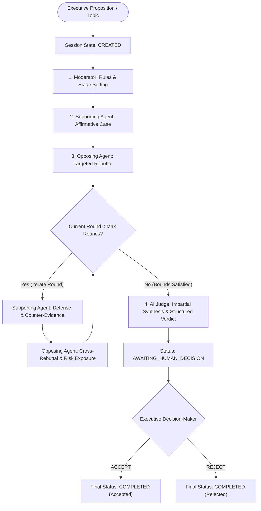
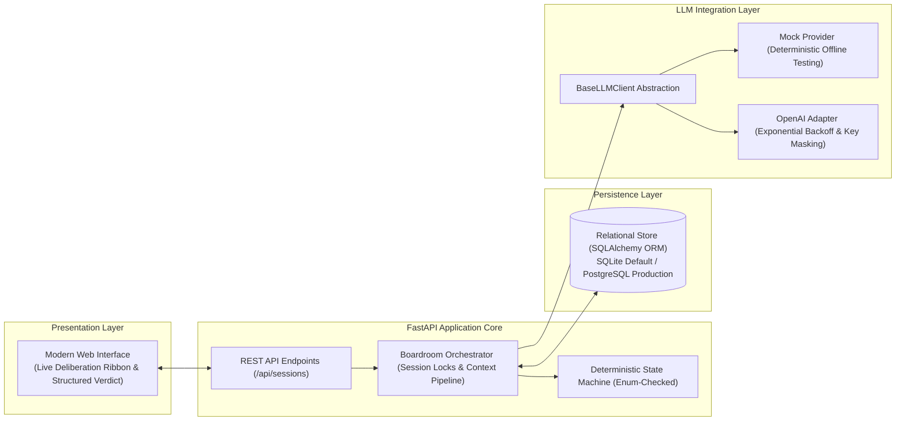

# Multi-Agent AI Boardroom
### *Enterprise Multi-Agent Deliberation & Executive Governance Platform*

[](https://www.python.org/)
[](https://fastapi.tiangolo.com/)
[](https://docs.pydantic.dev/)
[](https://www.sqlalchemy.org/)
[](tests/)
[](LICENSE)

---

## Executive Summary & Problem Statement

Unconstrained autonomous LLM agent loops present critical failure modes when applied to enterprise governance:
1. **Unbounded Deliberation & Cost Spikes**: Without deterministic halting conditions, autonomous agents wander into degenerative conversational loops or run up exponential token bills.
2. **Lack of Dialectical Scrutiny**: Single-prompt LLMs exhibit sycophancy, premature convergence, and confirmation bias.
3. **Black-Box Decision Making**: Opaque multi-agent chatter fails to surface verifiable trade-offs, structured dissent, or clear audit trails.
4. **Absence of Human-in-the-Loop Authority**: Purely automated agents should not unilaterally commit an enterprise to strategic, financial, or architectural decisions.

The **Multi-Agent AI Boardroom** solves these failure modes by orchestrating four specialized AI personas (**Moderator**, **Supporting Agent**, **Opposing Agent**, and **Judge**) across an explicit, deterministic Finite State Machine (FSM). The system forces structured dialectical debate, guarantees mathematical stopping limits, validates outputs with typed Pydantic v2 schemas, and places the executive human decision-maker as the final gatekeeper.

---

## Core System Architecture

The orchestration engine rejects loose agentic frameworks in favor of an **auditable, deterministic state transition model**. Each debate turn is persisted transactionally, serialized per session, and bound to immutable sequence numbers.



### Layered Architecture & Component Separation



---

## The Four Deliberation Personas

| Persona | Core Responsibility | Dialectical Function | Output Contract |
| :--- | :--- | :--- | :--- |
| **🏛️ Moderator** | Enforces discussion scope, establishes ground rules, and contextualizes the proposition. | Eliminates bias, frames boundary conditions, and sets turn sequencing. | Plaintext statement framed neutrally; zero affirmative or negative bias. |
| **🛡️ Supporting Agent** | Builds the strongest defensible affirmative case for the proposition. | Leverages empirical mechanisms, operational leverage, and upside models. In round 2+, directly defends against opponent's critique. | Unflinching affirmative reasoning directly addressing the proposition. |
| **⚔️ Opposing Agent** | Evaluates the actual supporting arguments presented in previous turns. | Uncovers fragile assumptions, unbudgeted capital/operational drag, technical debt, and risk vectors. | Targeted counter-arguments grounded in the opponent's recorded transcript. |
| **⚖️ AI Judge** | Synthesizes opposing arguments into an objective comparative balance sheet. | Weighs evidence quality, evaluates risk asymmetry, and issues an actionable recommendation. | **Strict Pydantic JSON Schema** (`VerdictStructuredOutput`). |
| **👤 Human Executive** | Evaluates the synthesized verdict and issues the binding governance decision. | Final authority. The AI recommends; the executive decides. | Binding verdict record (`ACCEPTED` or `REJECTED`) with executive rationale. |

---

## Production Engineering & Reliability Principles

### 1. Deterministic Bounded Execution
- **Strict Turn Bounds**: Debate rounds are strictly constrained ($1 \le \text{rounds} \le 5$, default: 2). Infinite agent ping-pong is mathematically impossible.
- **FSM Transitions**: Illegal state transitions (e.g., attempting to advance a completed session or jumping directly to verdict) raise `InvalidStateTransitionError` and return `400 Bad Request`.

### 2. Failure Recovery & Session Resilience
- **Partial Failure Resumption**: If an LLM call encounters network partition or timeout, the session transitions to `FAILED`. Prior turns remain committed in the relational database. Calling `POST /api/sessions/{id}/retry` re-enters the state machine at the exact interrupted turn without re-running completed steps.
- **Transactional Consistency**: Database operations are atomic per turn. Partial writes and corrupted session states are structurally prevented.

### 3. Concurrency Control & Idempotency
- **In-Process Mutex Serialization**: Every active session is governed by a dedicated in-memory lock (`_session_locks`) preventing race conditions from simultaneous requests.
- **Network Idempotency**: Turn advancement endpoints accept an `idempotency_key`. Redundant client retries return the current state without duplicate LLM inference or message duplication.

### 4. Zero-Trust Security & Credential Isolation
- **12-Factor Configuration**: Environment variables take absolute precedence over local configuration (`OS Environment > .env > Pydantic Defaults`).
- **Secret Sanitization**: Error logging routines pass raw provider exceptions through regex pattern scrubbers (`re.sub(r'sk-[a-zA-Z0-9]{20,}', '[REDACTED]', ...)`) ensuring API keys are never leaked to logs, client responses, or APM traces.
- **Zero-Secret Repository**: `.env` and SQLite databases are strictly excluded from source control.

---

## Structured AI Output: The Pydantic Verdict Schema

The AI Judge is constrained to an immutable Pydantic schema (`VerdictStructuredOutput`), guaranteeing valid deserialization:

```python
class VerdictStructuredOutput(BaseModel):
    strongest_supporting: str = Field(
        ..., description="The strongest reasonable argument presented in favor of the proposition."
    )
    supporting_weaknesses: str = Field(
        ..., description="Unaddressed gaps, unsupported assumptions, or risks in the supporting case."
    )
    strongest_opposing: str = Field(
        ..., description="The strongest counterargument or challenge presented against the proposition."
    )
    opposing_weaknesses: str = Field(
        ..., description="Unaddressed gaps, overstatements, or risks in the opposing case."
    )
    reasoning: str = Field(
        ..., description="Comparative evaluation of evidence, trade-offs, and logical consistency."
    )
    final_assessment: str = Field(
        ..., description="Balanced synthesized recommendation for the executive decision-maker."
    )
```

---

## Production Deployment & Operational Runbook

### Prerequisites
- Python 3.10+
- Virtual environment (`venv` or `conda`)

### 1. Installation
```bash
git clone https://github.com/harshthanki-codes/Multi_AI_Agent_System.git
cd Multi_AI_Agent_System
python -m venv .venv
source .venv/bin/activate  # On Windows: .venv\Scripts\activate
pip install -r requirements.txt
```

### 2. Environment Configuration
The platform runs out-of-the-box in hermetic **Mock Provider** mode (`LLM_PROVIDER=mock`), requiring zero external API keys or cloud spend.

To connect live OpenAI or Azure/compatible endpoints, configure `.env`:
```bash
cp .env.example .env
```
```ini
LLM_PROVIDER=openai
OPENAI_API_KEY=sk-proj-your-actual-api-key
OPENAI_MODEL=gpt-4o-mini
LLM_REQUEST_TIMEOUT_SECONDS=30.0
```

### 3. Launching the Service
```bash
python -m uvicorn app.main:app --host 127.0.0.1 --port 8000
```
- **Web Interface**: `http://127.0.0.1:8000`
- **Interactive OpenAPI Documentation**: `http://127.0.0.1:8000/docs`

---

## API Specification

| Method | Path | Summary | Description |
| :--- | :--- | :--- | :--- |
| `POST` | `/api/sessions` | Create Session | Initialize a boardroom debate topic and configure maximum rounds. |
| `GET` | `/api/sessions` | List Sessions | Retrieve paginated history of boardroom sessions and current states. |
| `GET` | `/api/sessions/{id}` | Get Session | Retrieve full session metadata, state machine status, and complete message transcript. |
| `POST` | `/api/sessions/{id}/advance` | Advance Turn | Advance the debate by exactly one discrete agent turn (idempotency-key supported). |
| `POST` | `/api/sessions/{id}/auto-run` | Auto-Run | Automatically orchestrate all debate turns through to `AWAITING_HUMAN_DECISION`. |
| `GET` | `/api/sessions/{id}/verdict` | Get Verdict | Fetch the validated structured JSON verdict produced by the AI Judge. |
| `POST` | `/api/sessions/{id}/decision` | Record Decision | Submit binding human decision (`ACCEPTED` / `REJECTED`) with optional audit rationale. |
| `POST` | `/api/sessions/{id}/retry` | Resume Session | Recover a `FAILED` session from its last successful turn without data loss. |

---

## Quality Assurance & Automated Test Suite

The repository includes a comprehensive, offline test suite covering lifecycle orchestration, state machine transitions, concurrency locks, schema validation, and error sanitization:

```bash
python -m pytest -v
```

```text
tests/test_api.py::test_api_session_lifecycle PASSED                     [  5%]
tests/test_api.py::test_api_invalid_topic PASSED                         [ 10%]
tests/test_boardroom.py::test_session_creation_and_input_validation PASSED [ 15%]
tests/test_boardroom.py::test_agent_execution_order PASSED               [ 21%]
tests/test_boardroom.py::test_context_passing_between_agents PASSED      [ 26%]
tests/test_boardroom.py::test_round_limit_enforcement PASSED             [ 31%]
tests/test_boardroom.py::test_judge_structured_verdict_validation PASSED [ 36%]
tests/test_boardroom.py::test_llm_timeout_marks_session_failed PASSED    [ 42%]
tests/test_boardroom.py::test_missing_credentials_raises_auth_error PASSED [ 47%]
tests/test_boardroom.py::test_partial_session_recovery_after_failure PASSED [ 52%]
tests/test_boardroom.py::test_idempotency_prevents_duplicate_messages PASSED [ 57%]
tests/test_boardroom.py::test_persistence_across_reconnect PASSED        [ 63%]
tests/test_boardroom.py::test_human_acceptance_and_rejection_workflow PASSED [ 68%]
tests/test_boardroom.py::test_complete_end_to_end_session PASSED         [ 73%]
tests/test_boardroom.py::test_state_machine_transition_validation PASSED [ 78%]
tests/test_boardroom.py::test_concurrent_session_advance_serialization PASSED [ 84%]
tests/test_boardroom.py::test_provider_selection_and_default_mock PASSED [ 89%]
tests/test_boardroom.py::test_malformed_judge_json_error_classification PASSED [ 94%]
tests/test_boardroom.py::test_error_message_does_not_leak_keys PASSED    [100%]

============================= 19 passed in 13.53s =============================
```

---

## Strategic Architecture Decisions & Enterprise Roadmap

### Key Trade-Offs Made
1. **Deterministic Custom FSM over LangGraph / CrewAI**:
   - *Rationale*: Generic multi-agent frameworks introduce unbounded dependency trees, prompt leakage, and unpredictable execution loops. A custom, explicit FSM provides 100% deterministic auditing, low memory overhead, and crystal-clear transaction boundaries.
2. **Synchronous REST Turn Execution vs. WebSockets**:
   - *Rationale*: Discrete HTTP `POST` turn execution provides immediate RESTful idempotency, reliable proxy caching, and step-by-step auditability without persistent socket connection drops across mobile/corporate networks.

### Roadmap & Enterprise Scaling
- **Distributed Lock Management**: Migrate in-process `_session_locks` to Redis (`redlock`) or Postgres advisory locks for multi-pod Kubernetes deployments.
- **Asynchronous Task Workers**: Decouple turn advancement into background Celery/ARQ workers with Server-Sent Events (SSE) for client streaming.
- **Domain Fine-Tuning**: Support role-specific model assignments (e.g., Claude 3.5 Sonnet for Opposing scrutiny, GPT-4o for Judge synthesis).
