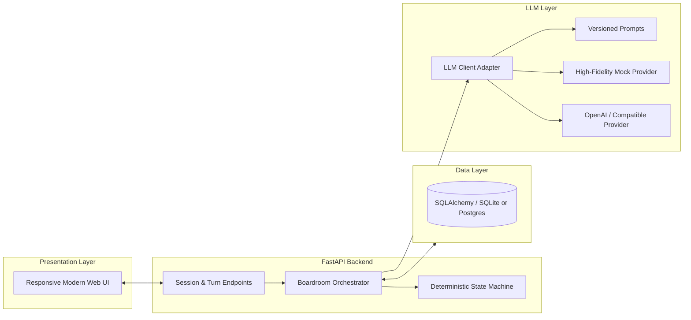

# Multi-Agent AI Boardroom

An enterprise-grade, bounded multi-agent deliberation platform built with **FastAPI**, **Pydantic v2**, and **SQLAlchemy**. The system orchestrates four distinct AI roles (**Moderator**, **Supporting Agent**, **Opposing Agent**, and **Judge**) to debate high-stakes technical or strategic propositions before presenting a structured, high-integrity verdict to an executive **Human Decision-Maker**.

---

## 🏛️ Architecture Overview

The system implements an explicit, deterministic Finite State Machine (FSM) where the **Moderator** strictly controls execution flow, turn bounds, and context handoff between opposing agents.

```mermaid
flowchart TD
    Start([User Topic]) --> CREATED[Status: CREATED]
    CREATED --> MOD[Moderator Opening]
    MOD --> SUPP_R1[Supporting Agent: Opening Case]
    SUPP_R1 --> OPP_R1[Opposing Agent: Rebuttal]
    
    OPP_R1 --> CHECK_ROUNDS{Round < Max Rounds?}
    CHECK_ROUNDS -- Yes (Round++) --> SUPP_RX[Supporting Agent: Defense & Counter]
    SUPP_RX --> OPP_RX[Opposing Agent: Cross-Rebuttal]
    OPP_RX --> CHECK_ROUNDS
    
    CHECK_ROUNDS -- No (Limit Reached) --> JUDGE[Judge: Synthesis & Structured Verdict]
    JUDGE --> AWAIT_HUMAN[Status: AWAITING_HUMAN_DECISION]
    
    AWAIT_HUMAN --> HUMAN_DECISION{Human Decision}
    HUMAN_DECISION -- ACCEPT --> COMPLETED_ACC[Status: COMPLETED (Accepted)]
    HUMAN_DECISION -- REJECT --> COMPLETED_REJ[Status: COMPLETED (Rejected)]
```

### System Component Diagram



---

## 🎭 Agent Roles & Behavior

1. **Moderator (Version 1.0.0)**:
   - Establishes discussion rules and states the proposition neutrally.
   - Enforces turn boundaries, prevents hallucinated external evidence, and sets the stage.
2. **Supporting Agent (Version 1.0.0)**:
   - Constructs the strongest reasonable affirmative argument with explicit reasoning and empirical mechanisms.
   - In subsequent rounds, directly refutes the opposing agent's actual objections rather than repeating opening remarks.
3. **Opposing Agent (Version 1.0.0)**:
   - Evaluates the actual supporting argument presented in previous turns.
   - Identifies fragile assumptions, hidden capital/operational costs, and points of systemic failure.
4. **Judge (Version 1.0.0)**:
   - Impartially assesses both arguments based on reasoning quality, relevance, and trade-offs.
   - Outputs a validated Pydantic JSON verdict detailing strongest points, weaknesses, and a recommended assessment.
5. **Human Executive**:
   - Holds final governance authority to **Accept** or **Reject** the verdict with executive caveats and timestamped persistence.

---

## 🚀 Quickstart & Setup

### Prerequisites
- Python 3.10+
- `pip`

### 1. Clone & Install Dependencies
```bash
git clone <repo-url>
cd gallant-shannon
pip install -r requirements.txt
```

### 2. Configure Environment Variables
Copy the `.env.example` file to `.env`:
```bash
cp .env.example .env
```

Default configuration runs in deterministic mock mode (`LLM_PROVIDER=mock`) requiring **no external API keys** or paid usage.

To connect your real OpenAI key:
```env
LLM_PROVIDER=openai
OPENAI_API_KEY=your_actual_openai_api_key_here
OPENAI_MODEL=gpt-4o-mini
```

### 3. Run the Application
```bash
python -m uvicorn app.main:app --host 0.0.0.0 --port 8000 --reload
```

Open your browser at: **`http://localhost:8000`**

---

## 📡 REST API Reference

| Method | Endpoint | Description |
|---|---|---|
| `POST` | `/api/sessions` | Create a new boardroom session with a topic and max rounds. |
| `GET` | `/api/sessions` | List recent boardroom sessions. |
| `GET` | `/api/sessions/{session_id}` | Retrieve session status, metadata, and full turn history. |
| `POST` | `/api/sessions/{session_id}/advance` | Execute exactly one discrete agent turn (supports `idempotency_key`). |
| `POST` | `/api/sessions/{session_id}/auto-run` | Automatically advance turns until reaching `AWAITING_HUMAN_DECISION`. |
| `GET` | `/api/sessions/{session_id}/verdict` | Retrieve the structured AI Judge's verdict. |
| `POST` | `/api/sessions/{session_id}/decision` | Record the final human decision (`ACCEPTED` or `REJECTED`) and rationale. |
| `POST` | `/api/sessions/{session_id}/retry` | Recover and resume a session marked `FAILED` without losing prior turns. |

---

## 🛡️ Reliability, Idempotency & Fault Tolerance

1. **Deterministic State Machine**: Unsanctioned jumps across debate states or calls after completion raise `InvalidStateTransitionError`.
2. **Duplicate Prevention**: Operations accept an `idempotency_key`. Repeating the same key returns the existing state without repeating LLM inference or appending duplicate messages.
3. **Partial-Session Recovery**: If an LLM call times out or encounters transient network errors, the session is marked `FAILED` while all previous turns remain safely committed in the database. Calling `POST /api/sessions/{id}/retry` seamlessly resumes from the exact failed step.
4. **Exponential Backoff & Jitter**: The OpenAI client retries transient rate limits and timeouts with randomized exponential backoff while immediately rejecting non-retryable 401/403 authentication failures.

---

## 🧪 Automated Test Suite

All 12+ deterministic test scenarios run offline without paid API credentials:
```bash
pytest -v
```

### Test Coverage Highlights:
- ✅ Session creation & Pydantic input validation.
- ✅ Correct deterministic agent execution order.
- ✅ Context passing: verified that opposing agents receive actual prior arguments.
- ✅ Bounded round-limit enforcement and stopping conditions.
- ✅ Judge Pydantic output schema validation.
- ✅ Authentication errors and LLM timeout handling.
- ✅ Partial-session failure recovery and state resumption.
- ✅ Idempotency & duplicate request prevention.
- ✅ Data persistence across separate SQLite connections/restarts.
- ✅ Human decision acceptance/rejection flow.
- ✅ Complete end-to-end deliberation lifecycle.

---

## 📋 Example Boardroom Deliberation

**Topic:** *"Should we migrate our monolithic backend to a distributed event-driven microservices architecture this quarter?"*

### Transcript:
1. **Moderator (Round 1)**:
   > "Welcome, members of the Boardroom. Today we convene to deliberate upon the submitted proposition. The objective is rigorous strategic scrutiny. The Supporting Agent will articulate the affirmative case... The Opposing Agent will challenge premises... The boardroom is now officially in session."

2. **Supporting Agent (Round 1)**:
   > "We strongly advocate for advancing this proposition. First, from an operational and strategic standpoint, it addresses critical developer bottlenecks and decouples high-velocity payment services from slower legacy modules. Second, industry benchmarks demonstrate that domain-driven microservices yield superior horizontal elasticity..."

3. **Opposing Agent (Round 1)**:
   > "I must challenge the affirmative case. The Supporting Agent relies on an overly optimistic assumption of organizational readiness. Decomposing a functional monolith introduces distributed transaction latency, eventual consistency hurdles, and observability overhead. Premature migration frequently diverts engineering focus from product delivery..."

4. **Judge Structured Verdict**:
   - **Strongest Supporting**: *"Targeted decoupling removes deployment contention and unlocks horizontal scaling for critical services."*
   - **Supporting Weaknesses**: *"Underestimates the severe operational overhead of distributed systems and observability complexity."*
   - **Strongest Opposing**: *"Highlighted that premature scaling without unified distributed tracing and team readiness creates operational drag."*
   - **Opposing Weaknesses**: *"Overly conservative bias that fails to provide a strategy for scaling past existing monolithic limits."*
   - **Final Assessment**: *"CONDITIONAL APPROVAL: Execute an initial strangler-fig pilot on one non-critical domain (e.g., Notifications) before authorizing enterprise-wide core migration."*

5. **Human Executive Decision**:
   - **Status**: `ACCEPTED`
   - **Timestamp**: `2026-10-16 13:30:00 UTC`
   - **Rationale**: *"Approved strictly as a pilot for the Notification service with latency SLAs."*

---

## ⚖️ Design Decisions & Trade-Offs

1. **Finite State Machine vs Autonomous Loop**:
   - *Decision*: We implemented a rigid, bounded state machine over an unconstrained autonomous loop.
   - *Rationale*: Enterprise boardroom deliberations require strict auditability, deterministic costs, predictable stopping bounds, and human control.
2. **Provider Agnostic LLM Interface**:
   - *Decision*: Abstracted LLM execution behind `BaseLLMClient` with both `MockLLMClient` and `OpenAILLMClient`.
   - *Rationale*: Guarantees that CI, testing, and initial evaluations cost $0 and run in milliseconds, while supporting real OpenAI/compatible models via `.env`.
3. **Database Architecture**:
   - *Decision*: Pure SQLAlchemy ORM with SQLite default and PostgreSQL compatibility.
   - *Rationale*: Zero-setup development and easy deployment to cloud PostgreSQL (e.g. Supabase, AWS RDS, Cloud SQL) simply by altering `DATABASE_URL`.
